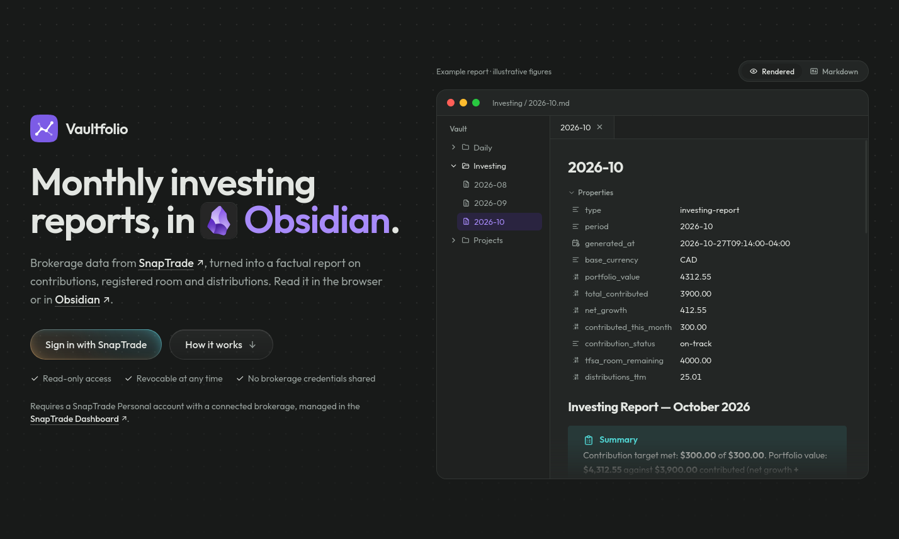

<p align="center">
  
</p>

<h1 align="center">Vaultfolio</h1>

<p align="center">
  <strong>Your investments, one Markdown note a month.</strong><br>
  Brokerage data from <a href="https://snaptrade.com">SnapTrade</a>, turned into a clear monthly report in Markdown. Read it in the browser or sync it into <a href="https://obsidian.md">Obsidian</a>.
</p>



## What each report covers

- **This month:** deposits, purchases and distributions, plus progress toward a monthly contribution target.
- **Growth:** total contributed against current value, in dollars.
- **TFSA, RRSP and FHSA room:** contributions this year, room remaining, and a warning before going over.
- **Distributions:** every payment over the past year, and an estimate for the next.

Reports state facts and never recommend trades. Every setting is optional: a report is complete from the first sign-in, and settings only add detail.

## Get started

1. Open [Vaultfolio](https://vaultfolio-tau.vercel.app) and choose **Sign in with SnapTrade**.
2. Approve read-only access in SnapTrade. A SnapTrade Personal account with at least one connected brokerage is needed; every connected brokerage is included.
3. Open **Reports**. Each month can be copied as Markdown, or a whole year downloaded as a zip.

## Obsidian

1. Download the plugin from Vaultfolio and unzip it into the vault's `.obsidian/plugins/` folder, as `plugins/vaultfolio/`.
2. Enable **Vaultfolio** under Settings → Community plugins, then choose **Connect**.
3. Reports appear in `Investing/` and update on startup or with **Vaultfolio: Sync now**.

Each report starts with frontmatter (`portfolio_value`, `tfsa_room` and more), ready for Dataview queries.

## Good to know

- **Read-only.** Vaultfolio cannot place trades, and brokerage passwords never reach it.
- **Nothing stored.** Reports are built on request from live data. [SECURITY.md](SECURITY.md) covers how access is protected.
- **No currency conversion.** Amounts in different currencies are kept separate rather than converted.
- **One day behind.** SnapTrade syncs transactions once a day, so the latest day may not appear yet.

## Run it locally

Requires Node.js 24, a Postgres database (Neon) and a SnapTrade OAuth app with `http://127.0.0.1:3000/oauth/snaptrade/callback` registered.

```bash
npm install
cp .env.example .env.local   # then fill in each value
npm run db:migrate
npm run dev                  # http://127.0.0.1:3000
```

Use `127.0.0.1`, not `localhost`, so the sign-in cookie matches the callback. `npm run check` runs formatting, lint, type checking and tests. Setting `VAULTFOLIO_MOCK_DATA=full` in `.env.local` replaces SnapTrade data with generated accounts for testing (also `us`, `sandbox` or `empty`); production builds ignore it.

---

<p align="center"><sub>Open source under the <a href="LICENSE">MIT License</a>. For information only. Not financial advice.</sub></p>
